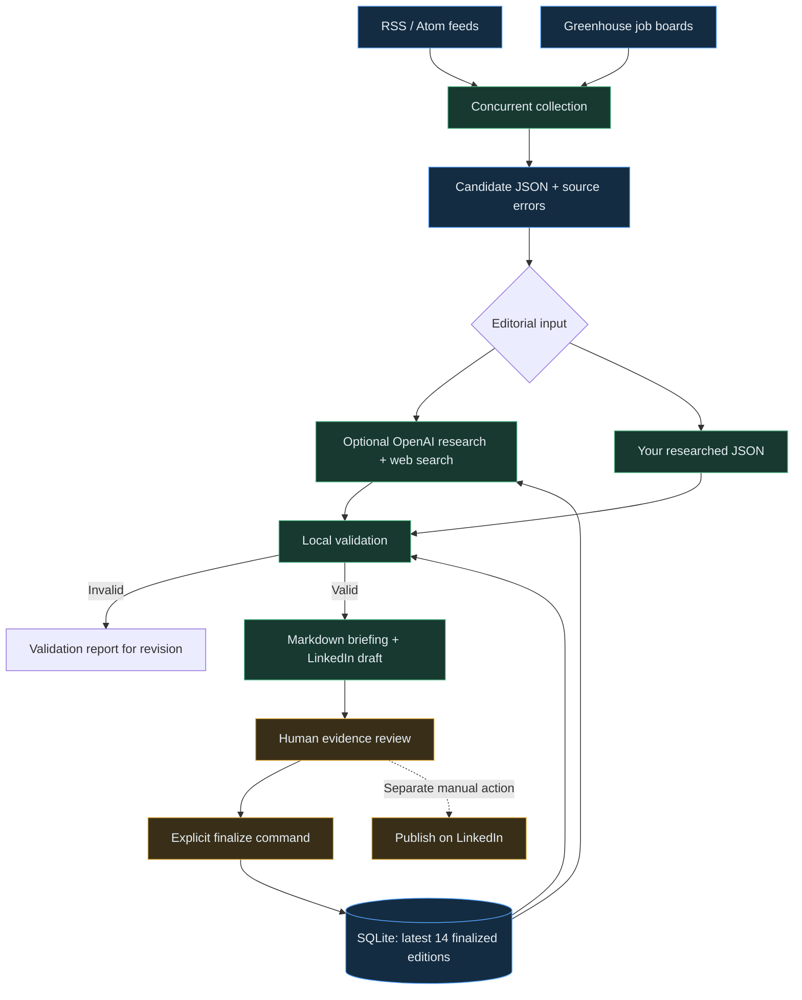

<div align="center">


# Personalized News Intelligence

**Turn technology news and career opportunities into a briefing worth reading—and a perspective worth sharing.**

A Python research pipeline with optional AI web research, structured editorial checks, and human review.

[](https://github.com/Skeeb32/personalized-news-intelligence/actions/workflows/checks.yml)
[](#quick-start)
[](#engineering-under-the-hood)
[](#architecture)

[](https://github.com/Skeeb32/personalized-news-intelligence/stargazers)
[](https://github.com/Skeeb32/personalized-news-intelligence/forks)
[](https://github.com/Skeeb32/personalized-news-intelligence/commits/main/)

[Quick start](#quick-start) · [Architecture](#architecture) · [Runtime guide](docs/runtime.md) · [Contribute](#contributing) · [Report an issue](https://github.com/Skeeb32/personalized-news-intelligence/issues)

</div>

---

## A better morning starts with better context

Technology professionals face two moving targets: what is changing in the industry, and where that change creates opportunity. Headlines, job boards, and social feeds rarely connect those dots for you.

**Personalized News Intelligence brings them into one repeatable editorial workflow.** Collect recent source material and official job listings. Research the implications. Produce five ranked developments, a carefully selected job list, sourced perspectives, and a concise LinkedIn draft. Review the evidence before recording the edition.

The interesting engineering problem is making those stages inspectable. Candidate data, editorial JSON, validation results, rendered drafts, and coverage history each have a clear place in the workflow.

> [!IMPORTANT]
> **Working CLI, early-stage project.** Collection, validation, rendering, and reviewed history are implemented. The optional OpenAI drafting integration requires your own API access and has not been live-tested in this project. No recurring schedule or automatic LinkedIn publishing is enabled. Structural validation does not establish factual accuracy.

## What you get

| Capability | What the code actually does |
| :--- | :--- |
| **📡 Source collection** | Reads RSS/Atom feeds and Greenhouse job boards concurrently, filters recent articles and relevant roles, and records source-specific failures. |
| **🔎 Optional AI research** | Sends candidates, editorial instructions, a configurable profile, and recent finalized editions to the OpenAI Responses API with web search. |
| **🧭 Editorial structure** | Requires five distinct event IDs, six impact scores per story, source URLs, perspectives, a philosophical closing, and a LinkedIn draft. |
| **💼 Job provenance** | Requires selected jobs to match collected identifiers, titles, companies, locations, and URLs. Fewer than ten requires a shortfall explanation. |
| **🧪 Draft validation** | Checks required fields, repeated events, duplicate jobs, application-review declarations, and the post's length and dash-punctuation rules. |
| **🗂️ Persistent context** | Stores finalized editions in SQLite and checks against the latest fourteen. Revisited event IDs require an explanation of what changed. |
| **✍️ Portable output** | Writes readable Markdown and plain text alongside JSON research records. No dashboard or proprietary editor is required. |

### One run, inspectable artifacts

```text
private/
├── history.sqlite              Reviewed coverage history
└── runs/
    └── YYYY-MM-DD/
        ├── candidates.json     Collected news, jobs, timestamps, source errors
        ├── editorial.json      Researcher's or model's editorial input
        ├── validation.json     Structural check results
        ├── briefing.md         Seven-part briefing, after checks pass
        └── linkedin.txt        Separate post draft, after checks pass
```

**The briefing:** overview → five developments → job opportunities → real perspectives → philosophical closing → LinkedIn draft → publishing checklist.

Collection creates the candidate packet. Research adds editorial and validation records. A valid draft adds the Markdown and text outputs. Private working files are ignored by Git.

## Architecture



### Engineering under the hood

| Decision | Implementation | Why it matters |
| :--- | :--- | :--- |
| Small runtime footprint | Python standard library: `urllib`, `ElementTree`, `sqlite3`, `zoneinfo`, `unittest` | No third-party runtime package installation. |
| Bounded collection | Four worker threads; 20-second fetch timeout; 5 MB response limit | Collection has explicit resource limits and isolates failures by source. |
| Consistent candidate IDs | Canonical URLs, tracking-parameter removal, truncated SHA-256 IDs | Repeated URLs can be identified after common tracking noise is removed. |
| Explicit editorial scoring | Six integer scores, each from 0 to 5; rendering sorts by their sum | Ranking logic is visible and reproducible from the editorial input. |
| Review before history | AI review flags are reset; finalization requires approval and a reviewer | A generated draft does not automatically become finalized coverage. |
| Durable local records | SQLite date primary key; duplicate finalization rejected | Coverage survives process restarts on persistent storage. |
| Bounded AI request | Configurable model, 240-second timeout, 12,000 output-token cap, no automatic retries | Request behavior is explicit; a token cap is not a dollar-spend guarantee. |

**Read the implementation:** [`newsintel/pipeline.py`](newsintel/pipeline.py) · **Read the tests:** [`tests/test_pipeline.py`](tests/test_pipeline.py)

## Quick start

### 1. Clone and check Python

You need **Git, Python 3.9+**, system time-zone data, and network access for live collection. CI uses Python 3.12 on Ubuntu. The examples below use a POSIX shell; on Windows, use the equivalent Python executable and environment-variable syntax.

```sh
git clone https://github.com/Skeeb32/personalized-news-intelligence.git
cd personalized-news-intelligence
python3 --version
```

There is no `pip install` or build step. Run the module from the repository root.

### 2. Collect your first candidates

```sh
python3 -m newsintel collect
```

Open the dated `private/runs/` directory printed by the command. Inspect `candidates.json`, including its `errors` array. A successful exit can include partial source failures; it means at least some news or jobs were collected.

**Default sources:** GitHub Blog and CISA feeds, plus the Anthropic and Cloudflare Greenhouse boards. Availability and result counts vary. An official job-board listing still needs its specific application page reviewed.

### 3. Make the research yours

For a local configuration that stays out of commits:

```sh
mkdir -p private
cp config.json private/config.json
```

Edit `private/config.json`, then pass `--config private/config.json` to your commands.

| Setting | Purpose |
| :--- | :--- |
| `timezone` | IANA time zone used for edition dates and the displayed publication target. |
| `lookback_hours` | Recent-news window; defaults to 72 hours. |
| `feeds` | Administrator-configured RSS/Atom source URLs. |
| `greenhouse_boards` | Greenhouse board tokens to query. |
| `job_keywords` | Case-insensitive title filters. |
| `locations` | Case-insensitive location filters; an empty list permits all locations. |
| `profile` | Context supplied to optional AI research. The default is generic. |

### 4. Choose your drafting path

<details open>
<summary><strong>Path A · Your own research, no API key</strong></summary>

Copy the editorial contract and replace its fictional examples with your researched material:

```sh
cp editorial.example.json private/editorial.json
```

Use job IDs and core listing fields from the collected packet. Complete all five developments, sources, perspectives, quotation, and post. Set `application_verified` only after checking each selected application page.

Replace `YYYY-MM-DD` with the actual collection folder date:

```sh
python3 -m newsintel run \
  --packet private/runs/YYYY-MM-DD/candidates.json \
  --editorial private/editorial.json
```

The example file demonstrates the format; it is not a ready-to-publish edition. Packets must be less than 24 hours old.

</details>

<details>
<summary><strong>Path B · Optional AI-assisted web research</strong></summary>

Set `OPENAI_API_KEY` securely in your shell or secret manager. Set `OPENAI_MODEL` to an available model supporting Responses API web search. See [`.env.example`](.env.example) for variable names; the application does **not** automatically load `.env` files.

After exporting both variables:

```sh
python3 -m newsintel run
```

This path collects candidates, requests research, validates the returned editorial JSON, and writes valid drafts. It sends the configured profile, candidate packet, instructions, and recent finalized history to OpenAI. API and web-search usage charges apply.

The integration is implemented, but paid API execution has not been live-tested in this project. Model access and tool compatibility depend on your account. Output still needs human verification.

</details>

### 5. Review, then record the edition

Check the evidence, quotes, active application pages, personal claims, and originality. In your editorial JSON, set:

```json
"review": {
  "approved": true,
  "reviewer": "Your name"
}
```

Then use the reviewed file:

```sh
python3 -m newsintel finalize \
  --packet private/runs/YYYY-MM-DD/candidates.json \
  --editorial private/editorial.json
```

If you used AI drafting, edit and pass the generated `private/runs/YYYY-MM-DD/editorial.json` instead. Finalization records coverage; it does not publish. Rendered outputs retain their draft label until you handle publication separately.

### 6. Run the checks

```sh
python3 -m unittest discover -s tests -v

# Standalone post punctuation check:
python3 scripts/validate_post.py private/runs/YYYY-MM-DD/linkedin.txt
```

For all command flags:

```sh
python3 -m newsintel --help
```

## Running beyond your laptop

**GitHub Actions:** open [Collect research candidates](https://github.com/Skeeb32/personalized-news-intelligence/actions/workflows/collect.yml), choose **Run workflow**, and download the `research-candidates` artifact. The workflow runs collection only and retains artifacts for seven days. Tests run on pushes and pull requests.

**Scheduled operation:** use an external, timezone-aware scheduler with the repository as its working directory, credentials in a secret store, and persistent SQLite storage. Start before the desired 6:00 AM completion time. Prevent overlapping runs and surface nonzero exits. No recurring schedule is installed by this repository.

**Preserving drafts:** rerunning for the same date uses the same output folder. Supply a distinct `--output` directory to retain alternatives. A failed validation can leave older rendered files in place, so inspect `validation.json` and timestamps before using a draft.

[Full runtime and scheduling guide →](docs/runtime.md)

## Project health, without the inflated numbers

The badges above show live repository stars, forks, commit activity, and CI status. These implementation facts are directly inspectable:

| Measure | Current implementation |
| :--- | :--- |
| Runtime dependencies | **0** third-party Python packages |
| Automated test cases | **9**, in the current test module |
| Collector concurrency | **4** workers |
| Candidate caps | **80** news items; **50** jobs per board, **100** overall |
| Historical context | Latest **14** finalized editions |
| Edition structure | **5** developments; target **10** jobs, with explicit shortfall reporting |

These are code limits and test counts, not performance benchmarks. The test suite exercises fictional fixtures and mocked failures; it does not certify live sources or the AI provider. No coverage percentage, throughput benchmark, or production availability claim is reported.

### What still requires judgment

A valid URL is not proof of a true claim. A required verification note is not independent evidence that an application is open. Matching event IDs catches known repeats, but identifying two differently named stories about the same event remains an editorial task. The review flag is an explicit workflow declaration, not an authenticated approval system.

These boundaries are part of the project's design: inspect the intermediate records, verify the sources, and keep publication deliberate.

## Repository map

```text
newsintel/                  CLI, collectors, research, validation, rendering, history
scripts/validate_post.py    Standalone LinkedIn punctuation checker
tests/test_pipeline.py     Offline unit and workflow tests
config.json                Public default research configuration
editorial.example.json     Fictional editorial contract example
prompts/                   Full research and writing instructions
templates/                 Manual seven-part edition template
docs/                      Runtime guide, editorial workflow, visual assets
history/coverage.csv       Optional manual ledger; CLI history uses SQLite
editions/                  Public archive location; initially empty
.github/workflows/         CI tests and manually triggered collection
```

## Roadmap

**Implemented**

- [x] RSS/Atom and Greenhouse collection with per-source error reporting.
- [x] Configurable source, role, location, and profile settings.
- [x] Optional OpenAI web-search drafting integration.
- [x] Editorial validation, ranking, and Markdown/text rendering.
- [x] Explicit review declarations and SQLite coverage history.
- [x] Offline tests and GitHub Actions workflows.

**Proposed next steps — contributions welcome**

- [ ] Live integration tests for AI drafting and provider response handling.
- [ ] More defensive schema validation and broader failure-case tests.
- [ ] Evidence snapshots and stronger application-page verification.
- [ ] Semantic event deduplication beyond supplied event IDs.
- [ ] Run-specific output directories and clearer finalization status.
- [ ] Durable scheduling with overlap prevention and failure notifications.
- [ ] Additional ATS adapters and broader source diversity.

These are proposed improvements, not features already delivered or a promised release schedule.

## Contributing

Good contributions make the research easier to inspect, the pipeline more reliable, or the setup easier to reproduce.

1. [Open an issue](https://github.com/Skeeb32/personalized-news-intelligence/issues) for a bug, source-adapter proposal, or substantive behavior change.
2. Fork the repository, clone your fork, and create a focused branch.
3. Make the change and add tests for meaningful behavior changes. Keep fixtures fictional and offline.
4. Run `python3 -m unittest discover -s tests -v`.
5. Open a pull request explaining the problem, resulting behavior, validation, and any limitations. Update documentation when commands or editorial rules change.

**Useful starting points:** malformed API responses, RSS edge cases, link normalization, source failures, duplicate handling, and clearer error messages. Never commit credentials, private career details, real resumes, or raw private research history.

**License status:** this repository currently has no license file. Public visibility does not itself grant an open-source license; clarify reuse terms with the maintainer before redistribution or incorporation into another project.

## For engineers, hiring managers, and recruiters

This project demonstrates a complete vertical slice: ingestion → normalization → optional model integration → validation → rendering → persistent state.

| Skill demonstrated | Where to inspect it |
| :--- | :--- |
| API integration and concurrency | `collect()` and `fetch()` in [`pipeline.py`](newsintel/pipeline.py) |
| Data normalization and identity | `canonical()`, `identity()`, and RSS/Atom parsing |
| AI application integration | `research()`, configurable model selection, explicit request bounds, and review reset |
| Domain-specific validation | `validate()`: story counts, score ranges, job provenance, repetition, and post rules |
| Persistence and workflow modeling | SQLite edition history and the separate `run` / `finalize` commands |
| Testable engineering | Mocked source failures and end-to-end draft/review/history tests in [`tests/`](tests/test_pipeline.py) |
| Developer experience | Dependency-free CLI, inspectable artifacts, runtime documentation, and CI |

The scope is a compact research CLI. Its strongest evidence is readable implementation and repeatable tests, rather than unmeasured claims about scale.

---

<div align="center">

### Build a more informed morning.

**Try the collector. Inspect the evidence. Make the workflow your own.**

If this project is useful, **⭐ star it** to help others discover it.<br>
[Fork and experiment](https://github.com/Skeeb32/personalized-news-intelligence/fork) · [Suggest an improvement](https://github.com/Skeeb32/personalized-news-intelligence/issues) · [Explore the code](newsintel/pipeline.py)

Built by [Skeeb32](https://github.com/Skeeb32)

</div>
